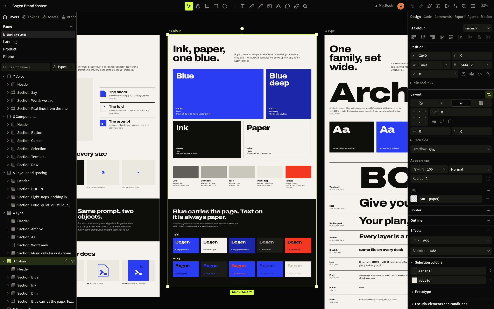

# Bogen

An open source design canvas where every layer is real HTML and CSS, and your own coding agent draws on it with you.
Claude Code, Codex or another MCP client draws while you watch, edit and decide. Bogen is made for Omarchy, where it
also designs complete desktop themes.

<p>
  <a href="LICENSE"></a>
  
  
</p>



## Quickstart

You need Node 22.18 or newer and a Chromium-based browser (Chromium, Chrome, Brave or Edge). Omarchy ships with
Chromium.

```sh
curl -fsSL https://bogen.dev/install.sh | bash
bogen open
```

The script downloads the release from GitHub, checks it against its checksum and the release signature, and installs
it for your user: the package in `~/.local/share/bogen-app`, the `bogen` command in `~/.local/bin`. On Omarchy it then
sets up the user service, the launcher entry, the keybinding and the bar widget; `--no-omarchy` leaves that out. It
never uses `sudo`. [Read it first](install.sh) if you like.

Or let your coding agent do it. Tell Claude Code or Codex: "Set up Bogen for me: bogen.dev/agent".

From a checkout of this repository:

```sh
npm install
npm run build
alias bogen="node $PWD/packages/server/dist/cli.js"
bogen open
```

`bogen open` starts the server in the background and opens `http://127.0.0.1:29990` in your browser. The first
start makes one file, Welcome to Bogen, that walks through the basics. Then check your setup:

```sh
bogen doctor
```

It checks the whole setup, prints the exact fix for each problem, and changes nothing.

You can try Bogen without an agent subscription: the home screen has four finished example designs and 20 Omarchy
theme templates to open and edit by hand. [Getting started](docs/guide/getting-started.md) walks through a first
file.

## Connect your agent

```sh
bogen install claude-code
bogen install codex
```

`bogen install` registers Bogen's MCP server with the client and, for Claude Code and Codex, writes a small skill
file (`skills/bogen/SKILL.md` in `~/.claude` or `$CODEX_HOME`). `bogen uninstall <client>` removes both.

Then ask your agent, in its own window:

```text
Design a pricing page in Bogen.
```

Keep the canvas open and watch it draw. The agent works on your own Claude or Codex plan, and that plan's limits
apply; Bogen needs no API key and calls no AI provider itself.

Other clients: `bogen install` also knows `cursor`, `vscode`, `opencode`, `gemini`, `zed`, `grok`, `hermes` and
`omp`, and `--all` sets up every client it finds. Only Claude Code and Codex have been tried with the real apps.
Anything else that speaks MCP can connect to `bogen mcp` (stdio) or `http://127.0.0.1:29990/mcp` (Streamable HTTP).
The [MCP tool reference](docs/guide/reference/mcp-tools.md), generated from a running server, lists every tool.

You can also stay on the canvas: Ctrl+K runs your installed `claude` or `codex` CLI with Bogen's tools only, and a
comment that mentions `@claude` or `@codex` starts a run that answers in the thread.

## Design an Omarchy theme

1. Add the desktop integration. It is optional, and gives you the launcher entry, bar widget and user service:

   ```sh
   bogen omarchy install --dry-run    # prints every step, changes nothing
   bogen omarchy install
   ```

2. On the home screen choose Themes, then Omarchy Desktop. Open one of the 20 bundled templates, start from a theme
   you have installed, or start a new one. With an agent connected you can ask instead:

   ```text
   Make an Omarchy theme in Bogen, starting from tokyo-night, warmer and with less contrast.
   ```

3. The theme is one file on the canvas: the palette as tokens, the backgrounds for landscape and portrait screens,
   and previews that redraw when a token changes.

4. In the theme dialog, Install copies the theme to `~/.config/omarchy/themes/<name>`. Apply switches to it, and
   Undo apply goes back to the theme you had. An agent can design and install a theme; only you can apply one, and
   an agent never replaces a theme that is already there.

5. To share it, export with Git repository checked. You get a folder named `omarchy-<name>-theme` that anyone can
   install the usual way once you have pushed it:

   ```sh
   omarchy theme install https://github.com/you/omarchy-dusk-theme
   ```

The [Omarchy guide](docs/guide/omarchy.md#design-a-theme) has the details, including portrait monitors, what an
exported theme contains and which parts have been run on a real desktop.

## What it does

- **A canvas made of HTML and CSS.** A frame is a `<div>` with flex or grid, text is text, colours are CSS
  variables. What you see, what the agent sees in a screenshot and what you export come from the same rendering.
- **You and your agent in one file.** The agent draws over MCP; you edit by hand at the same time. Larger changes
  arrive as proposals you accept or discard, every change is on a timeline with who made it, and you can undo one
  agent's work without touching your own.
- **Omarchy themes.** Palette, backgrounds and previews on one canvas, exported as a standard theme folder or Git
  repository.
- **Checks before you ship.** Contrast, overflow, small text and touch targets, token use, and responsive widths;
  a brand with rules that designs are checked against.
- **Out to code and files.** HTML, React, and React with Tailwind from any layer; PNG, JPG, WebP, AVIF, SVG, PDF,
  MP4 and WebM.

Bogen can also copy a live web page onto the canvas as editable layers, keep files in sync between two of your own
machines over Tailscale, and show proposals and comments on your phone. See the [documentation](docs/guide/README.md).

## How it works

`bogen` is one Node program. It runs a server on your machine at `127.0.0.1:29990` that stores your files in
`~/.local/share/bogen`, serves the editor as a web page, and exposes the same operations to agents as MCP tools. A
headless Chromium, the one already on your system, renders screenshots and exports, so an agent can look at its own
work. There is no account and no Bogen cloud. When an agent works in Bogen, the request and what the tools return
(layers, comments, screenshots) go to your agent client and from there to its provider, as with any other agent
task.

## Requirements

| | |
| --- | --- |
| System | Linux. Developed and tested on Arch Linux with Omarchy, on x86_64 and aarch64. |
| Node | 22.18 or newer |
| Browser | Chromium, Chrome, Brave or Edge on your `PATH`, or its path in `BOGEN_BROWSER`. Without one the canvas and MCP tools work, but nothing can be rendered or exported. |
| Optional | `ffmpeg` for video and AVIF export; the `claude` or `codex` CLI for agent runs; Tailscale for device sync and the phone |
| For `bogen omarchy install` | `omarchy`, `jq` and `curl` |

## What it changes on your machine

- The install script adds the package in `~/.local/share/bogen-app` and the `bogen` command in `~/.local/bin`. On
  Omarchy it then runs `bogen omarchy install`, described below.
- Your files live in `~/.local/share/bogen` (or `$XDG_DATA_HOME/bogen`, or `BOGEN_HOME`).
- `bogen install <client>` adds one MCP entry to that client's config, and a skill file for Claude Code and Codex.
- `bogen omarchy install` writes into `~/.config/hypr`, `~/.config/omarchy`, `~/.config/systemd/user` and
  `~/.local/bin`: a user service, a launcher entry, a bar widget, theme and font hooks, a `.bogen` file type, and
  window rules and keys for Hyprland. Keys are checked against `hyprctl binds` and never replace an existing
  binding. Anything it replaces that it did not write is backed up to `~/.local/state/bogen/backups/` first, and
  `--dry-run` prints every step without changing anything. It does not use `sudo` unless you pass `--tailnet`,
  which offers to open the firewall for device sync. The [Omarchy guide](docs/guide/omarchy.md#install) lists
  every path.

## Uninstall

Three steps, in this order. The first two need the `bogen` command, so the package goes last.

```sh
bogen uninstall claude-code codex    # 1. every client you connected
bogen omarchy uninstall              # 2. only if you ran bogen omarchy install; --dry-run shows the steps
bogen stop                           # 3. stop the server, then remove the package and the command:
rm -r ~/.local/share/bogen-app ~/.local/bin/bogen
```

What stays behind, on purpose:

- your designs in `~/.local/share/bogen`,
- the installer's backups in `~/.local/state/bogen/backups/`,
- caches in `~/.cache/bogen/`,
- any themes you installed into `~/.config/omarchy/themes`,
- the firewall rule, if you opened one for device sync. `bogen omarchy uninstall` prints the `ufw` command that
  removes it.

Delete those yourself if you want them gone.

## Security and privacy

- **Local only.** The server listens on `127.0.0.1:29990`. There is no login for your own user: any program you run
  can use it. Other users of the machine, other web pages and DNS rebinding are refused.
- **An agent acts as you inside Bogen.** A connected agent can change every Bogen file and export files under your
  home folder. It can install a theme, but it cannot apply or replace one, start agent runs or publish anything.
  Every agent change can be undone.
- **No telemetry.** Bogen sends no usage statistics or crash reports. Once a day the server fetches one public file
  from GitHub to see whether a newer release exists; `bogen update off` turns that off.

[Privacy](docs/guide/privacy.md) lists every network request Bogen makes. [SECURITY.md](SECURITY.md) describes each
listener and how to report a vulnerability privately.

## Status and known limits

Bogen 0.1.0 is the first version. It is maintained by one person.

- **Tested on Arch Linux with Omarchy only.** The server and editor need nothing from Omarchy and may run on other
  Linux systems, but that has not been tried.
- **Agents:** Claude Code and Codex are tested with real runs. The other clients follow their documented config
  formats and have not been tried with the apps.
- **Themes:** the portrait background plugin for rotated monitors is experimental. Bogen does not create intro
  videos for a theme; it keeps the ones a theme already has.
- **Figma import** was built from Figma's public API documentation and has not run against the real API.
- **Phone:** the phone is a companion to Bogen on your computer, reached over Tailscale; it does not run Bogen
  itself. Tried on an iPhone, not on an iPad or Android.
- **Device sync** between two machines works over Tailscale; both sides editing while disconnected has been tested
  on one machine only.
- **Not there:** team accounts and roles, a desktop app, a browser extension for Capture, `.fig` files.

Each guide says where a feature works only in part, and the [feature matrix](docs/SPEC.md#feature-matrix) marks
every item as done, partly there or open.

## Documentation

| I want to | Guide |
| --- | --- |
| Install Bogen and make a first file | [Getting started](docs/guide/getting-started.md) |
| Connect an agent and see what it can do | [Agents](docs/guide/agents.md), [MCP tool reference](docs/guide/reference/mcp-tools.md) |
| Design and share an Omarchy theme | [Omarchy](docs/guide/omarchy.md) |
| Learn the canvas | [Canvas](docs/guide/canvas.md), [Components](docs/guide/components.md) |
| Set up a brand and check designs against it | [Brands](docs/guide/brand.md) |
| Copy a live site onto the canvas | [Capture and import](docs/guide/capture-and-import.md) |
| Export images, video or code | [Export and code](docs/guide/export-and-code.md) |
| Go back, branch, or keep a design in Git | [History](docs/guide/history.md) |
| Use two machines or my phone | [Devices](docs/guide/devices.md) |
| Fix something | [Troubleshooting](docs/guide/troubleshooting.md), [FAQ](docs/guide/faq.md) |
| Look up a command | [Command line](docs/guide/reference/cli.md) |

The [documentation index](docs/guide/README.md) lists every guide, and the
[changelog](docs/guide/changelog.md) says what is in this version.

## Contributing

Issues and pull requests are welcome; for a larger change, open an issue first. [CONTRIBUTING.md](CONTRIBUTING.md)
has the build and test commands and the rules for changes, and [Architecture](docs/architecture.md) explains how
the packages fit together. A report of what happened when you tried Bogen on a system or client listed above as
untested is a useful contribution.

## Related

[Tomacco](https://tomacco.dev) is a sibling project by the same author that builds, runs and tests Android and iOS
apps on Linux. Bogen can import a real app screen from it and compare a design against it; neither needs the other.
See [Tomacco](docs/guide/tomacco.md).

## Legal notice

- **Independent.** Bogen is an independent project. It is not affiliated with, endorsed by or sponsored by Paper
  (Lost Coast Labs) or Figma, and is independent of Omarchy. Names identify compatible tools.
- **Clean room.** Bogen is written from scratch, from public documentation, web standards and permissively licensed
  packages, with its own MCP tool names, schemas and file format. The Paper Desktop app and its bundles, and any
  reverse engineered clone of a design tool, were never read, copied or used as a source. The rule is in the
  [spec](docs/SPEC.md#clean-room-rule).
- **Shaders.** Shader layers use `@paper-design/shaders` and `@paper-design/shaders-react`, under the Apache License
  2.0. Their license and NOTICE are in [THIRD_PARTY_NOTICES.md](THIRD_PARTY_NOTICES.md).
- **Figma import** uses Figma's public REST API with your own personal access token.
- **No warranty.** Bogen is supplied without warranty, as the GNU General Public License states.

## License

Copyright (C) 2026 Marsel Nenaj and Bogen contributors.

Bogen is free software: you can redistribute it and modify it under the terms of the **GNU General Public License,
version 3 or (at your option) any later version**; see [LICENSE](LICENSE). Designs, code and themes you make with
Bogen are yours: the [exception for exported work](LICENSE-EXCEPTION.md) lets you use the code Bogen writes into your
exports under terms of your choice. The Omarchy bar plugin in
`integrations/omarchy/plugin` and the portrait background files Bogen derives from Omarchy stay under the MIT
license, like Omarchy itself. The bundled theme artwork is dedicated to the public domain under CC0 1.0, so themes
made from it can be published under any terms. Third-party packages keep their own licenses,
listed in [THIRD_PARTY_NOTICES.md](THIRD_PARTY_NOTICES.md). Asset origins and generated-art disclosure are in [ASSET_PROVENANCE.md](ASSET_PROVENANCE.md).
